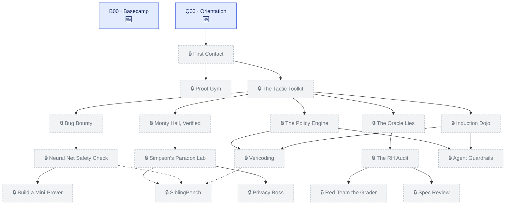

# 🗺️ Jonathan's map

_Rewritten automatically after every push. Don't edit it; edit your quest files and log.md._

**Rank:** Apprentice Verifier · **XP:** 0  
▱▱▱▱▱▱▱▱▱▱▱▱ next: **Sorry Slayer** at 100 XP

**Badges:** 🐣 Hatched  
🎟️ **Detour tokens:** 2 left · 💡 **Hints revealed:** 0 · 🎓 **Career cards:** 0 of 19 → [CAREER_CARDS.md](CAREER_CARDS.md)

> 🏕️ **Start at Basecamp:** fill in [intake.md](intake.md) (10 minutes). The Game Master plans your route from it. Start Quest 00 (Orientation) while you wait.

## 🐾 Your menagerie · 0 of 20 hatched

                   

Every quest hides an egg. 🥚 waiting · 🐣 hatching (you've started that quest) · clear the quest to hatch its companion. Hover over one to meet it.

## Next up

1. **B00 · Basecamp** (🆕, ⏱ 15-20 min): Why this game exists, a 3-minute tour of the field, and your interests. The Game Master plans your route from this. → [`intake.md`](intake.md)
2. **Q00 · Orientation** (🆕, ⏱ 20-30 min) 🧮●○○ ⌨️: A 20-minute tour of the moves you'll use everywhere: calculate, take apart, rewrite, the autopilots, exact?. Open puzzles: `compute`, `use_it`, `swap_and`, `two_cases`, `substitute`, `witness`, `expand`, `squeeze`. → [`quests/Q00_Orientation.lean`](quests/Q00_Orientation.lean)

## 🧭 Your field map

**Your interests:** rate the seven regions in [intake.md](intake.md) (section 1), and this map will suggest quests that match.  
What the symbols mean, and every quest rated: [docs/QUEST_GUIDE.md](../../docs/QUEST_GUIDE.md) · in the terminal: `python3 scripts/expedition.py guide`

> **Stuck?** Any of these is fine:
> 1. `python3 scripts/expedition.py hint <puzzle>` shows one hint at a time (math idea first, then the Lean move).
> 2. Switch to another quest in *Next up*; prerequisites open at 60%, so you never need every puzzle.
> 3. Spend a detour token (2 left): `python3 scripts/expedition.py detour <QuestID>` opens any locked quest on your next push.
> 4. Write "stuck on ..." in log.md, and the Game Master's next dispatch will help.

📬 Latest notes from the Game Master: [DISPATCH.md](DISPATCH.md) · Field Guide: [docs/FIELD_GUIDE.md](../../docs/FIELD_GUIDE.md)

## Map

## All quests

| | Quest | Path | Focus | Progress | XP |
|---|---|---|---|---|---:|
| 🆕 | B00 · [Basecamp](intake.md) | Basecamp |  |  | 0 |
| 🆕 | Q00 · [Orientation](quests/Q00_Orientation.lean) | Core trail | 🧮●○○ | 0/10 | 0 |
| 🔒 | Q01 · First Contact | Core trail | 🧮●●○ |  | 0 |
| 🔒 | T0 · Proof Gym | Training | 🧮●●● |  | 0 |
| 🔒 | Q02 · The Tactic Toolkit | Core trail | 🧮●○○ |  | 0 |
| 🔒 | Q03 · Induction Dojo | Core trail | 🧮●●○ 💻●●○ |  | 0 |
| 🔒 | Q04 · The Oracle Lies | Core trail | 🧮●●● 🤖●●● |  | 0 |
| 🔒 | Q05 · The RH Audit | Core trail | 🔍●●● 🧮●●○ |  | 0 |
| 🔒 | Q06 · Spec Review | Core trail | 🤖●●● 🔍●●● |  | 0 |
| 🔒 | Q07 · Red-Team the Grader | Core trail | 🛡️●●● 🔍●●● |  | 0 |
| 🔒 | S1 · Monty Hall, Verified | Statistician's Path | 🎲●●● |  | 0 |
| 🔒 | S2 · Simpson's Paradox Lab | Statistician's Path | 🎲●●● 📏●●○ |  | 0 |
| 🔒 | S3 · Privacy Boss | Statistician's Path | 🎲●●○ 🛡️●●○ |  | 0 |
| 🔒 | A1 · Bug Bounty | Machine Whisperer's Path | 💻●●● 🤖●●● |  | 0 |
| 🔒 | A2 · Neural Net Safety Check | Machine Whisperer's Path | 🛡️●●● 🧮●●○ |  | 0 |
| 🔒 | A3 · Build a Mini-Prover | Machine Whisperer's Path | 📏●●● 🧮●●○ |  | 0 |
| 🔒 | V1 · The Policy Engine | Verified Systems Path | 💻●●● 🤖●●○ |  | 0 |
| 🔒 | V2 · Vericoding | Verified Systems Path | 💻●●● 🤖●●● |  | 0 |
| 🔒 | V3 · Agent Guardrails | Verified Systems Path | 🛡️●●● 💻●●○ |  | 0 |
| 🔒 | CAPSTONE · SiblingBench | Co-op | 🎲●●● 📏●●● |  | 0 |

## Your trail

Newest first · times in UTC

_Your trail starts with your first push._

Legend: 🆕 ready · 🛠️ in progress · ✅ cleared · 💥 doesn't compile · ⚠️ puzzle missing · 🔒 locked Focus: 🧮 Pure math · 🎲 Statistics & probability · 💻 Verified software & policies · 🤖 Checking AI output · 🛡️ AI safety & security · 📏 Evaluation & benchmarks · 🔍 Trust & auditing · ●●● main focus, ●●○ a big part, ●○○ a touch · ⌨️ you write programs · 🧠 a real AI in the loop (? = optional) · 🎨 open-ended
