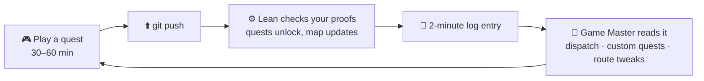
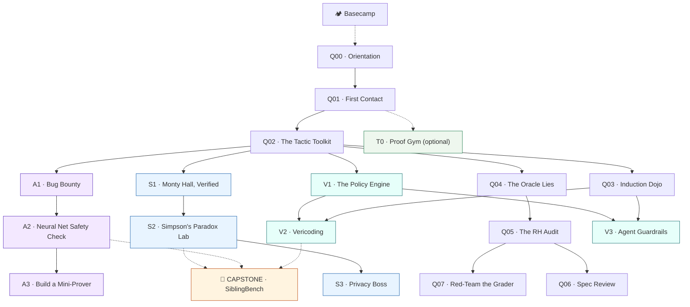

# Proof or It Didn't Happen

**A winter-break expedition into Lean 4, the language AI labs use to check whether math (and code) is actually true.**

On November 20, 2026, a mathematician released about **17 million lines of Lean**, written with Claude, which claim to prove the **Riemann Hypothesis**, the most famous open problem in mathematics. No human has read all of it. A day later the Lean and Mathlib communities certified it correct anyway, because Lean checked every step.

As AI writes more of the world's math and code, the scarce skill is **knowing what's true**. This repo is a game for learning that skill: 30 to 60 minutes at a time, at your own pace, on a route that adapts to you.

---

## How it works



- Every `sorry` in a quest file is a puzzle. **Lean is the only judge.** You can't bluff it, and neither can an AI.
- After each push, a GitHub Action compiles your files, counts what you've proved, **unlocks new quests** into your folder, and redraws your map (`Players/<you>/MAP.md`).
- Every quest you clear unlocks a **career card** (`Players/<you>/CAREER_CARDS.md`): where that skill shows up in real AI and verification jobs, a stretch goal, and an honest résumé line. Notes marked 🧑‍🔬 ON THE JOB inside the quests make the same connection while you play.
- The **Game Master** (Claude, with Dad in the loop) reads your intake, your logs and your actual proofs. It writes you dispatches, builds **custom quests just for you**, and reshapes your route. Your route won't look like your sibling's.

## Start here (15 minutes)

1. **Open a dev environment.** The easiest way is GitHub Codespaces (Code → Codespaces → *Create codespace on main*); the first boot takes a few minutes while it downloads Mathlib. Or install locally. Both are covered in **[START_HERE.md](START_HERE.md)**.
2. In the terminal: `python3 scripts/expedition.py join YourName`
3. Fill in **`Players/YourName/intake.md`** (Basecamp, 15–20 min). It opens with why this game exists and a quick tour of the seven regions of the field, which you rate by interest. This is how your route gets planned.
4. Commit and push. Then open `Players/YourName/quests/Q00_Orientation.lean`: a 20-minute tour of Lean, and your first quest.

## Every session

```bash
git pull                                        # new quests and dispatches arrive this way
# ...play...
python3 scripts/expedition.py status            # instant check of your proofs, no push needed
python3 scripts/expedition.py hint t4           # stuck? one hint at a time
# add a few lines to Players/YourName/log.md
git add -A && git commit -m "Q02: knights solved" && git push
```

## The quest library

Your route picks from this map. The Game Master can open quests early, hide ones you don't need, reorder things, and add new quests built from your intake.



| Trail | Quests | Flavor |
|---|---|---|
| **Core** | Q00 to Q07 | A 20-minute orientation, Lean basics, logic, induction, catching an AI that lies, auditing the Riemann Hypothesis proof, reviewing AI-written statements, red-teaming a proof grader |
| **Training** | T0 | Proof Gym: paper proofs next to Lean ones, for when proofs feel rusty |
| **Statistician's Path** | S1 to S3 | Monty Hall, Simpson's paradox, differential privacy |
| **Machine Whisperer's Path** | A1 to A3 | Verifying AI-written code, neural-network robustness, building an LLM + Lean prover |
| **Verified Systems Path** | V1 to V3 | Lean outside pure math: a Cedar-style access-control engine, reviewing an AI's code + spec + proof, and proving guardrails for an AI agent |
| **Co-op** | CAPSTONE | Build a benchmark, test AI models, analyze the results properly. The portfolio piece. |

**Which quests are for you?** Every quest is rated on seven regions of the field: 🧮 pure math, 🎲 statistics, 💻 verified software & policies, 🤖 checking AI output, 🛡️ AI safety & security, 📏 evaluation and 🔍 trust & auditing. The **[Quest Guide](docs/QUEST_GUIDE.md)** explains each region and rates every quest; your map suggests the best matches for the interests you gave at Basecamp, and `python3 scripts/expedition.py guide` ranks them in the terminal.

## House rules

- **Stuck is normal.** `hint <puzzle>` gives one hint at a time (logged, no penalty). Prerequisites open at 60%, so you can always switch quests, and you get 2 detour tokens (`detour <QuestID>`) to open any locked quest early. The [Field Guide](docs/FIELD_GUIDE.md) has the whole unsticking routine.
- **Break the Expedition.** The engine has a deliberate blind spot (Quest 05 hints at it; Quest 07 lets you exploit it legally). If you find any *other* way to fool it, don't use it: describe it in your log for a bounty. Red-teaming the grader is real AI-safety work.
- **AI is allowed as a sparring partner.** Ask a chatbot, paste its Lean, and see if it compiles. Log what happened. Catching AI mistakes is half the point.
- **Don't delete puzzles.** The engine notices. 😉 Don't edit `MAP.md` or the scoreboard either; they're regenerated.
- **Tired? Busy? Bored?** Write it in your log ("something chill", "harder", "more stats"). The route bends.
- It isn't a race. (Okay, it's a little bit of a race.)

<!-- EXPEDITION:START -->
### 🏔️ Live scoreboard

No verifiers yet. Run `python3 scripts/expedition.py join YourName`, then commit and push.

<!-- EXPEDITION:END -->

---

## What's in this repo

| Path | What |
|---|---|
| `Quests/` | Quest templates (the library). Your copies live in your player folder. |
| `Players/<you>/` | Your intake, quests, log, map, dispatches and route |
| `tools/miniprover/` | An LLM + Lean proving loop (Quest A3 and the capstone) |
| `docs/QUEST_GUIDE.md` | The seven regions of the field, and every quest rated on them (the table is generated from `expedition/quests.json`) |
| `docs/CHEATSHEET.md` | Tactics, symbols, error messages and git, on one page |
| `docs/FIELD_GUIDE.md` | How Lean thinks, how to get unstuck, how to search Mathlib, what you'll use where |
| `docs/CAREERS.md` | The jobs this leads to, a day in the life, and the ten-skill map |
| `docs/WHY_NOW.md` | The Riemann Hypothesis story and what's happening at the edge of AI and Lean |
| `GAME_MASTER.md` | The Game Master's rulebook (yes, you can read it) |
| `scripts/expedition.py` | The engine: checks proofs, unlocks quests, gives hints, logs your trail, draws maps |
| `Quests/hints/` | The hint ladders (spoilers; use the `hint` command instead) |
| `Quests/cards/` | Career cards, one per quest |
| `expedition/history.jsonl` | Everyone's trail: unlocks, progress, clears, hints, detours |
