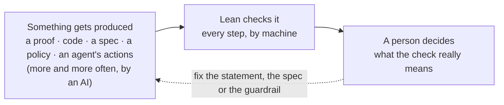

# 🧭 Quest Guide

Every quest practices a different mix of the field. This page shows each quest's mix so you can pick the ones you'll enjoy, and explains what each region of the field is and why it matters. The ratings are approximate: a guide, not a grade.

## The big picture

The whole game is one loop, repeated in different places:

The seven regions are the places this loop runs. The first three are about **what** gets verified. The last four are about **verifying AI**: checking what it produces, keeping it safe, measuring it, and knowing what a check really guarantees.

| | Region | The question it asks | Where it shows up at work |
|---|---|---|---|
| **What gets verified** | 🧮 Pure math | Is this theorem true? | AI-for-math teams, formalization projects, Mathlib |
| | 🎲 Statistics & probability | Does this method keep its promises about chance and data? | Privacy engineering, AI evaluation, data science |
| | 💻 Verified software & policies | Does this code or rule do what it claims, for every input? | Verification engineers, automated-reasoning teams |
| **Verifying AI** | 🤖 Checking AI output | Is what the AI produced what was actually asked for? | Formalization reviewers, verified-code-generation teams |
| | 🛡️ AI safety & security | What must this system never do, and can we prove it can't? | Safety research, security, agent infrastructure |
| | 📏 Evaluation & benchmarks | How good is this AI, really? | Evaluation teams, AI institutes, research engineers |
| | 🔍 Trust & auditing | What does "verified" actually guarantee here? | Everyone above; the Riemann Hypothesis audit |

## The seven regions

### 🧮 Pure math
Proving theorems about numbers, functions and structures. It's where Lean started, and Mathlib, its shared library, now holds hundreds of thousands of theorems written by a worldwide community. It's also where AI provers are tested hardest, because a math proof is right or wrong with nothing in between: AlphaProof, Aristotle, AxiomProver, Gauss and Claude all made headlines with Lean-checked math (see [WHY_NOW.md](WHY_NOW.md)). Strong math helps in every other region too. In the game: the Proof Gym, the Oracle's claims, induction, the RH audit, and the math half of the mini-prover benchmark.

### 🎲 Statistics & probability
Proving facts about chance and data: that an estimator is unbiased, that a privacy mechanism protects every individual, why a paradox happens. Formal statistics is still a small corner of Lean, which is exactly why a statistician who can do it stands out. It connects to AI in two ways. Privacy guarantees (AWS's SampCert is a Lean-verified differential-privacy library) protect the data AI is trained on, and evaluation of AI systems is a statistics problem from end to end. In the game: Monty Hall, Simpson's paradox, the privacy boss, and the capstone analysis.

### 💻 Verified software & policies
Proving that code, configurations and access rules do what they claim for every input, not just the inputs someone tested. This is the biggest industrial use of formal methods: AWS's Cedar access-control language is verified in Lean, and teams at AWS, Microsoft, chip makers and security firms prove properties of compilers, protocols and policies. Much of that work uses other tools as well (Dafny, Verus, Rocq, SMT solvers); the ideas transfer directly. In the game: verifying small programs (Q03), the bug bounty (A1), the policy engine (V1) and vericoding (V2).

### 🤖 Checking AI output
Deciding whether something an AI produced is what was actually asked for. Lean guarantees the proof is valid, but not that it proves the right statement, that a spec is strong enough, or that a policy change does only what it should. As AI writes more of the world's proofs and code, this becomes the human's main job, and companies already pay reviewers to check AI-written Lean. In the game: the Oracle's lies (Q04), the spec review (Q06), the bug bounty (A1), the AI's policy change (V1) and the AI's pull request (V2).

### 🛡️ AI safety & security
Proving that a system *can't* do certain harmful things: a classifier can't be flipped by tiny noise, a data release can't expose one person, an agent can't overspend, a grader can't be gamed. The key idea is that you don't have to prove an AI is good if you can prove something about the shield around it. This is the direction of "guaranteed-safe AI" research, such as the UK's ARIA *Safeguarded AI* program. Honest note: most AI-safety work doesn't use Lean, but in its formal-methods corner, Lean skills are rare and valued. In the game: red-teaming the grader (Q07), privacy (S3), neural-network robustness (A2), and agent guardrails (V3).

### 📏 Evaluation & benchmarks
Measuring AI systems honestly: building test sets, running models, and telling a real improvement from luck or contamination. Lean problems make excellent benchmarks because every answer is checked automatically, so they're widely used to evaluate AI reasoning. Evaluation teams exist at every AI lab, at government AI institutes and at independent evaluators, and they need statistics as much as code. In the game: the mini-prover benchmark (A3), the capstone (SiblingBench), and the evaluation side of Simpson's paradox and red-teaming.

### 🔍 Trust & auditing
Knowing exactly what "verified" guarantees, and what it doesn't. A proof can lean on a hidden axiom; a statement can quietly drift from the original; a grader can be fooled by an optimizer that only cares about reward. This region is how the Lean community certified the 17-million-line Riemann Hypothesis proof in a day: independent rebuilds, independent checkers, and tools confirming the statement really was RH. It's also the core skill in reward hacking and specification gaming, two central problems in AI alignment. In the game: the RH audit (Q05), the spec review (Q06) and red-teaming the grader (Q07).

## How to use the ratings

- **Follow your interests.** Your map shows *Best matches for your interests*, based on what you rated in your intake. `python3 scripts/expedition.py guide` ranks every quest for you in the terminal, and `guide safety,code` ranks them for any mix you name.
- **Check your mix.** Your map also shows *What your puzzles have practiced so far*. If one region is at 70%, a quest from another region is a cheap way to broaden what you can show an employer.
- **Change your mind.** Edit the interest ratings in your intake whenever you like. The change shows up in your trail, and the Game Master takes it into account.
- **It's a guide, not a rule.** A quest rated ●○○ in your favorite region can still be the one you like best.

<!-- RATINGS:START -->
## Every quest, rated

_Generated from `expedition/quests.json`. Ratings are approximate: · none, ●○○ a touch, ●●○ a big part, ●●● the main focus. ✓ = yes, ◐ = optional. Difficulty ★☆☆ gentle, ★★☆ steady, ★★★ stretch._

| Quest | ⏱ min | 🧮 | 🎲 | 💻 | 🤖 | 🛡️ | 📏 | 🔍 | ⌨️ | 🧠 | 🎨 | Difficulty | Opens after |
|---|---|:---:|:---:|:---:|:---:|:---:|:---:|:---:|:---:|:---:|:---:|:---:|---|
| **Q00** · Orientation Core trail | 20-30 | ●○○ | · | ●○○ | · | · | · | · | ✓ |  |  | ★☆☆ | start |
| **Q01** · First Contact Core trail | 30-45 | ●●○ | · | ●○○ | ●○○ | · | · | · | ✓ |  |  | ★☆☆ | Q00 |
| **T0** · Proof Gym Training | 30-45 | ●●● | · | · | · | · | · | · |  |  |  | ★☆☆ | Q01 |
| **Q02** · The Tactic Toolkit Core trail | 45-60 | ●○○ | · | ●○○ | · | · | · | · |  |  |  | ★☆☆ | Q01 |
| **Q03** · Induction Dojo Core trail | 30-45 | ●●○ | · | ●●○ | · | · | · | · | ✓ |  |  | ★★☆ | Q02 |
| **Q04** · The Oracle Lies Core trail | 45-60 | ●●● | · | · | ●●● | · | ●○○ | · |  | ◐ |  | ★★☆ | Q02 |
| **Q05** · The RH Audit Core trail | 45-60 | ●●○ | · | · | ●●○ | ●○○ | · | ●●● |  |  |  | ★★☆ | Q04 |
| **Q06** · Spec Review Core trail | ~45 | ●●○ | · | ●●○ | ●●● | · | · | ●●● |  |  | ✓ | ★★☆ | Q05 |
| **Q07** · Red-Team the Grader Core trail | ~45 | · | · | ●○○ | ●○○ | ●●● | ●●○ | ●●● | ✓ |  | ✓ | ★★☆ | Q05 |
| **S1** · Monty Hall, Verified Statistician's Path | 30-45 | ●○○ | ●●● | ●○○ | · | · | ●○○ | · |  |  |  | ★☆☆ | Q02 |
| **S2** · Simpson's Paradox Lab Statistician's Path | 45 | ●○○ | ●●● | · | · | · | ●●○ | · |  |  | ✓ | ★★☆ | S1 |
| **S3** · Privacy Boss Statistician's Path | 60 | ●○○ | ●●○ | ●○○ | · | ●●○ | · | · |  |  |  | ★★☆ | S2 |
| **A1** · Bug Bounty Machine Whisperer's Path | 45 | ●○○ | · | ●●● | ●●● | · | · | · | ✓ | ◐ |  | ★★☆ | Q02 |
| **A2** · Neural Net Safety Check Machine Whisperer's Path | 45-60 | ●●○ | · | ●○○ | · | ●●● | ●○○ | · |  |  |  | ★★☆ | A1 |
| **A3** · Build a Mini-Prover Machine Whisperer's Path | 60-90 | ●●○ | · | ●●○ | ●●○ | · | ●●● | · | ✓ | ✓ | ✓ | ★★★ | A2 |
| **V1** · The Policy Engine Verified Systems Path | ~45 | · | · | ●●● | ●●○ | ●●○ | · | · | ✓ |  |  | ★★☆ | Q02 |
| **V2** · Vericoding Verified Systems Path | 45-60 | · | · | ●●● | ●●● | · | · | ●●○ | ✓ |  | ✓ | ★★☆ | V1, Q03 |
| **V3** · Agent Guardrails Verified Systems Path | 45-60 | · | · | ●●○ | ●○○ | ●●● | ●○○ | · |  |  |  | ★★☆ | V1, Q03 |
| **CAPSTONE** · SiblingBench Co-op | several sessions | ●○○ | ●●● | ●○○ | ●●○ | · | ●●● | · | ✓ | ✓ | ✓ | ★★★ | one of S2, A2, V2 |

🧮 Pure math · 🎲 Statistics & probability · 💻 Verified software & policies · 🤖 Checking AI output · 🛡️ AI safety & security · 📏 Evaluation & benchmarks · 🔍 Trust & auditing · ⌨️ You write programs · 🧠 A real AI in the loop · 🎨 Open-ended: you design something

## Pick by interest

- **🧮 Pure math.** main focus: T0, Q04; a big part: Q01, Q03, Q05, Q06, A2, A3; a touch: Q00, Q02, S1, S2, S3, A1, CAPSTONE.
- **🎲 Statistics & probability.** main focus: S1, S2, CAPSTONE; a big part: S3.
- **💻 Verified software & policies.** main focus: A1, V1, V2; a big part: Q03, Q06, A3, V3; a touch: Q00, Q01, Q02, Q07, S1, S3, A2, CAPSTONE.
- **🤖 Checking AI output.** main focus: Q04, Q06, A1, V2; a big part: Q05, A3, V1, CAPSTONE; a touch: Q01, Q07, V3.
- **🛡️ AI safety & security.** main focus: Q07, A2, V3; a big part: S3, V1; a touch: Q05.
- **📏 Evaluation & benchmarks.** main focus: A3, CAPSTONE; a big part: Q07, S2; a touch: Q04, S1, A2, V3.
- **🔍 Trust & auditing.** main focus: Q05, Q06, Q07; a big part: V2.

## Pick by how you like to work

- **⌨️ You write programs:** Q00, Q01, Q03, Q07, A1, A3, V1, V2, CAPSTONE.
- **🧠 A real AI in the loop:** A3, CAPSTONE (optional in Q04, A1).
- **🎨 Open-ended: you design something:** Q06, Q07, S2, A3, V2, CAPSTONE.

In the terminal, `python3 scripts/expedition.py guide` ranks these for your interests, and `python3 scripts/expedition.py guide safety,code` ranks them for any mix you name.
<!-- RATINGS:END -->
